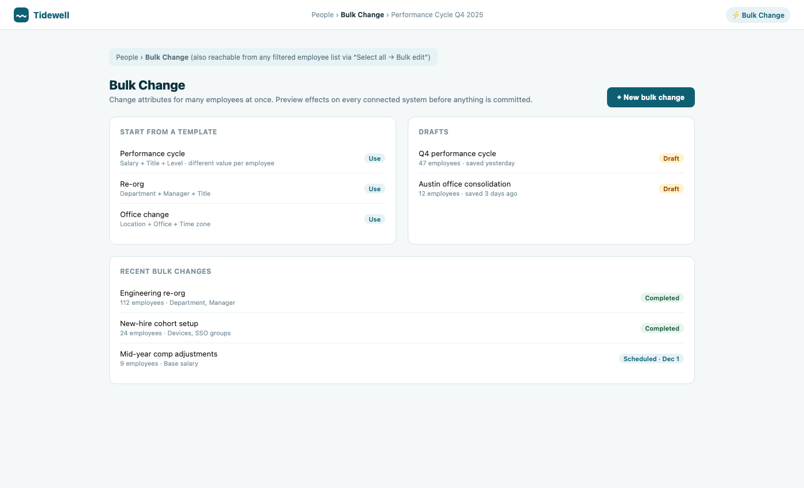
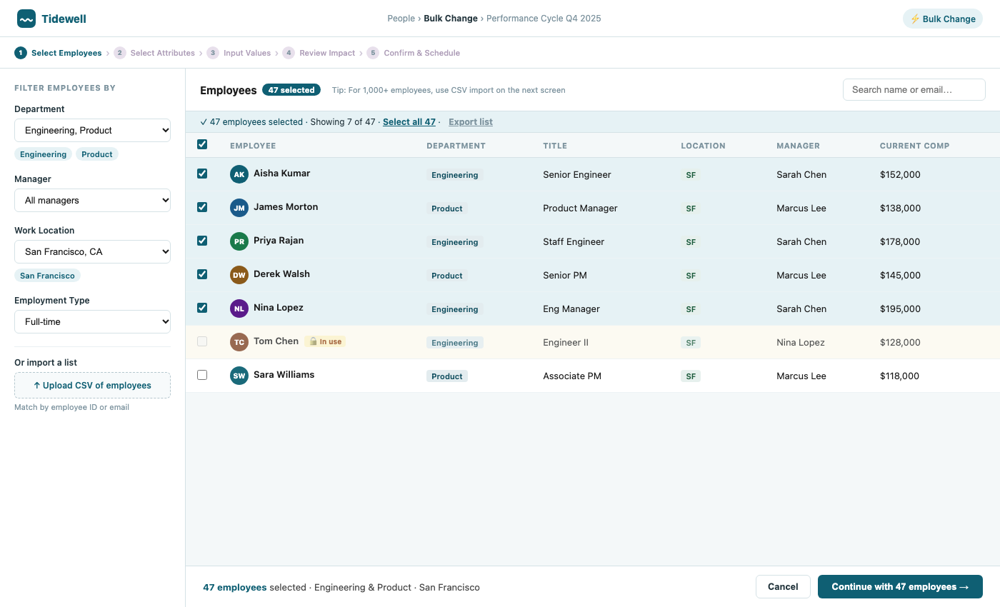
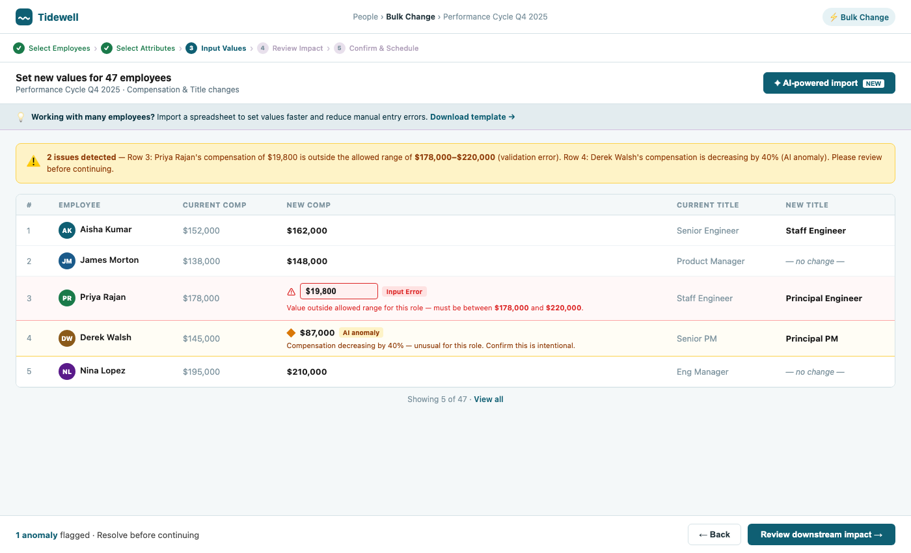
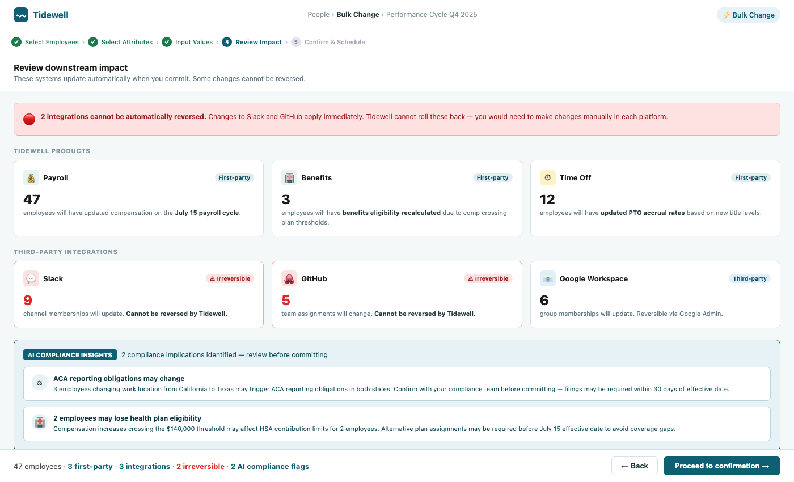
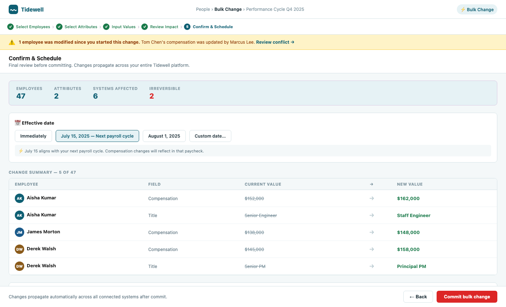

# Bulk Change: a clickable concept for an HR platform

Admins in an HR and payroll platform still change employee records one at a time. This prototype lets them change many at once: select a cohort, enter values (uniform or different per employee), preview the effect on every connected system, then commit or schedule.

**Live demo:** https://chaudharys.github.io/enterprise-bulk-change-concept/

**Run locally:** open `index.html` in a browser. No build step, no dependencies.

**Full product thinking** (problem, use cases, user segments, pain points, alternatives, decisions): see [PRD.md](PRD.md).

## Demo flow

| Step | Screen | What to look at |
|---|---|---|
| 0 | **Entry** | Templates, drafts and recent bulk changes. Click **+ New bulk change**. |
| 1 | **Select employees** | Filter by department, manager and location with a live count, or import a CSV. The "In use" lock badge marks a record another admin is editing. |
| 2 | **Select attributes** | Pick the **Performance Cycle** template (adds Salary, Title, Level). Templates add fields rather than replace them. Try the AI-import mapping with confidence scores. |
| 3 | **Enter values** | One row per employee. Red = hard rule error, amber = soft anomaly warning. |
| 4 | **Impact preview** | See what the change touches in first-party products and connected apps. Two integrations are flagged as not automatically reversible. |
| 5 | **Confirm and schedule** | Commit now or schedule for the next payroll cycle. Use the toggle on the results screen to flip between full success and partial failure. |

| | |
|---|---|
|  |  |
|  |  |

## Design focus
Designed for the hardest case first: a performance cycle where every employee gets a different value and errors hit paychecks. The flow therefore leans on prevention (validation, impact preview, scheduling) rather than an undo button. AI is phase 2, not part of the v1 core.

## Disclaimer
Independent concept. Not affiliated with or endorsed by any company. All names and data are fictional.
